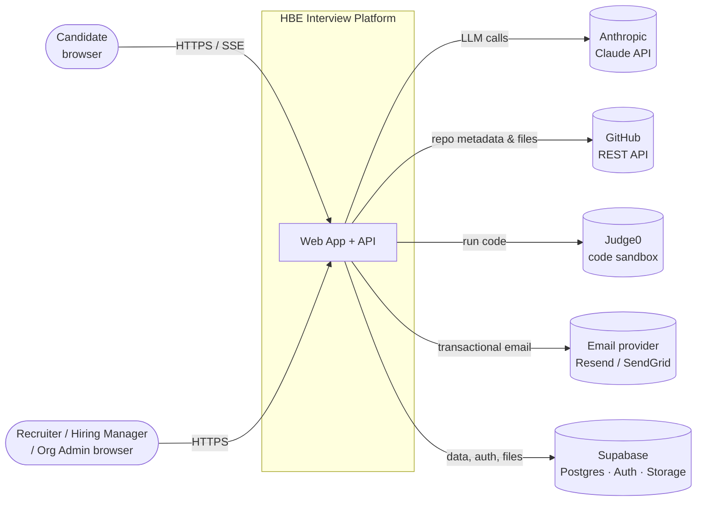
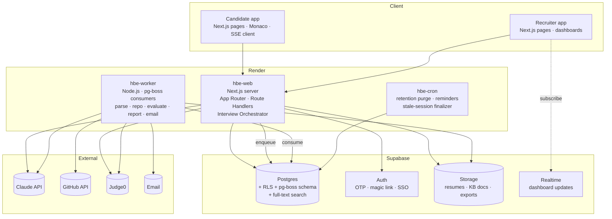
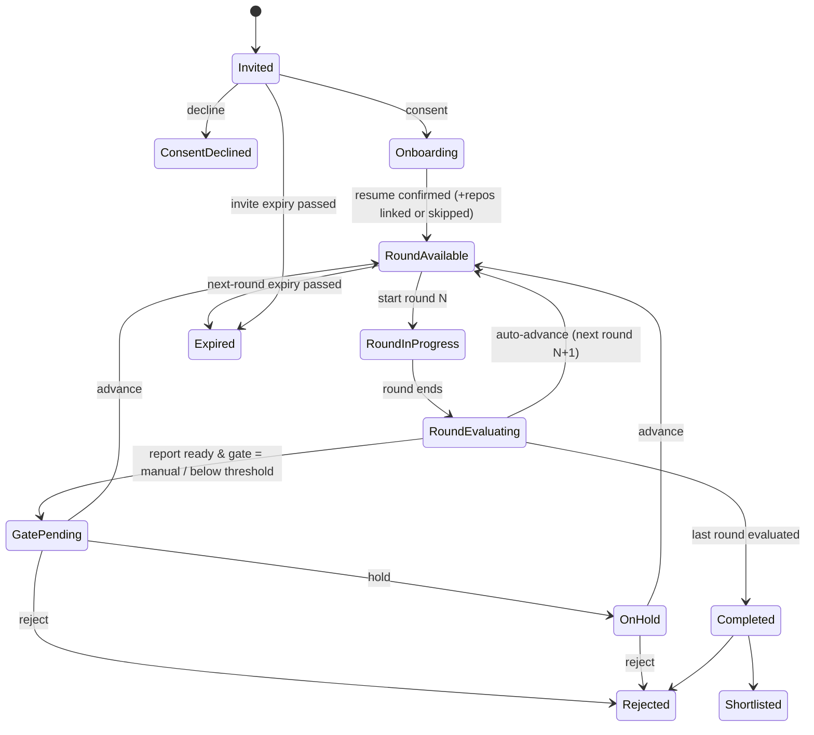
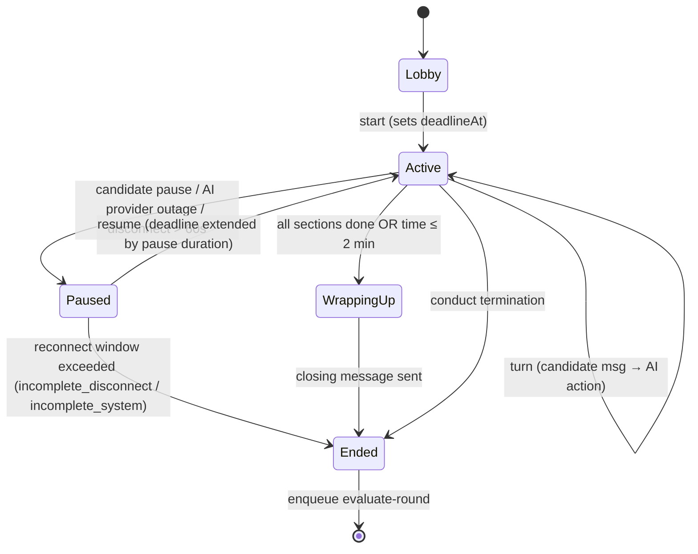
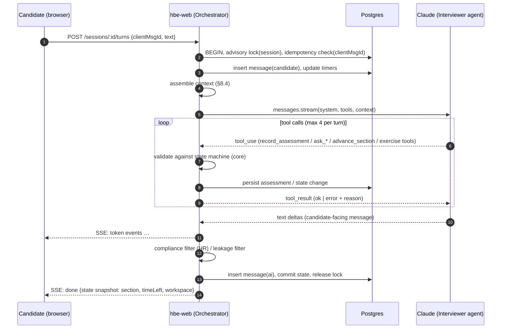
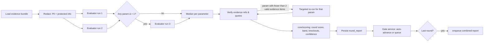
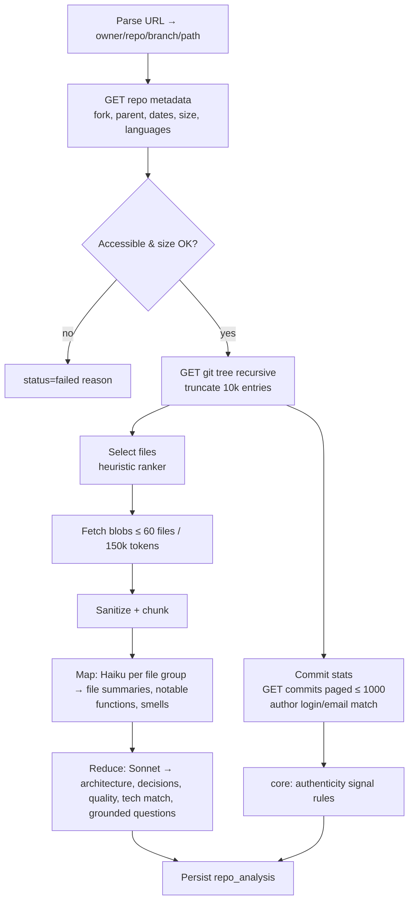
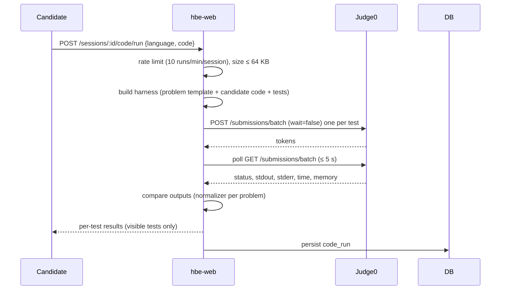
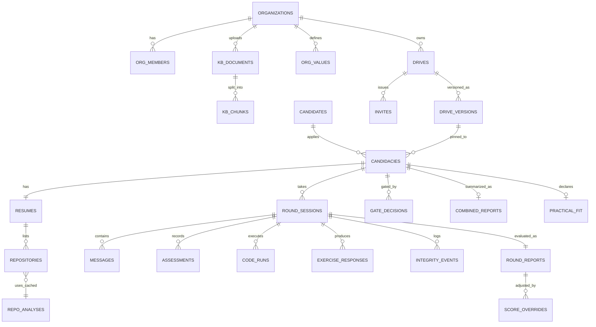

# HBE Interview — Technical Architecture

| | |
|---|---|
| **Document status** | v1.6 — approved; Phases 1–5 implemented (see §0 for as-built decisions; integration API in [API.md](API.md)) |
| **Date** | 2026-10-16 |
| **Related** | [PRD.md](PRD.md) · [FEATURES.md](FEATURES.md) · [API.md](API.md) |

---

## Contents

0. [As-built decisions (v1.2)](#0-as-built-decisions-v12)
1. [Scope](#1-scope)
2. [Architectural principles](#2-architectural-principles)
3. [System context](#3-system-context)
4. [Container view](#4-container-view)
5. [Technology stack](#5-technology-stack)
6. [Codebase structure](#6-codebase-structure)
7. [Domain model & services](#7-domain-model--services)
8. [Interview orchestration engine](#8-interview-orchestration-engine)
9. [AI layer](#9-ai-layer)
10. [GitHub ingestion & analysis pipeline](#10-github-ingestion--analysis-pipeline)
11. [Code execution](#11-code-execution)
12. [Data architecture](#12-data-architecture)
13. [API specification](#13-api-specification)
14. [Realtime & streaming](#14-realtime--streaming)
15. [Background jobs](#15-background-jobs)
16. [Security architecture](#16-security-architecture)
17. [Observability](#17-observability)
18. [Deployment, environments & CI/CD](#18-deployment-environments--cicd)
19. [Scalability, performance & cost](#19-scalability-performance--cost)
20. [Resilience & failure modes](#20-resilience--failure-modes)
21. [Testing strategy](#21-testing-strategy)
22. [Architecture decision records](#22-architecture-decision-records)

---

## 0. As-built decisions (v1.2–v2.1)

The product owner approved the design with these decisions. **Where this section conflicts with later sections, this section wins**; later sections describe the target architecture and the scale-out path.

| Decision | As built |
|---|---|
| Database | **Neon Postgres** (instead of Supabase). Accessed with Drizzle ORM over the `pg` driver; migrations in `drizzle/` applied by `npm run db:migrate`. Use Neon's **direct** endpoint (not `-pooler`): the interview engine takes session-level advisory locks |
| Auth | Built-in: staff email + password (bcrypt) with signed HTTP-only JWT cookies (`jose`); roles admin / recruiter / hiring manager / viewer. Candidates use a **personal bearer link** (`/c/{token}`, 192-bit random) issued by invite or open registration — no account needed |
| File storage | Resumes stored in Postgres (`bytea`, ≤ 5 MB); HR knowledge-base documents stored as extracted text. No separate object store |
| Realtime | Candidate interview turns stream over **SSE**; status pages poll. No Supabase Realtime |
| Tenancy | **Multiple organisations (v1.5).** `organizations` table; `org_id` on users, drives, candidates, candidacies (denormalised), KB documents/passages, API keys, webhooks, AI calls and audit. Application-level isolation: every staff session carries `orgId`; `canSeeDrive(user, drive)` takes the row so the org check can't be skipped; `requireDriveAccess`/`requireDrivePage`/`assertCandidacyAccess` load by id and answer 404 for other organisations; list queries filter by `orgId`; API keys and webhooks are org-scoped; `emitEvent(orgId, …)`. Candidates are per-organisation (unique `org_id + email`). Candidate links, open links and share links resolve their organisation through the token. Platform admins (`users.platform_admin`) can create/suspend organisations and switch into one (JWT `org` claim; they act as its admin, with a banner). Suspension blocks staff sign-in and API keys, never candidates mid-process. Verified route-by-route by `scripts/smoke-phase4.ts`. Postgres RLS is not used (would need per-request transactions with the pooled driver) — a defence-in-depth option for later |
| Background jobs | Postgres `jobs` table with `FOR UPDATE SKIP LOCKED`, retries with exponential back-off, singleton keys and `:failed` handlers. The worker runs **inside the web process** by default (`RUN_WORKER_IN_PROCESS=true`) or standalone via `npm run worker` |
| Code execution | **Judge0** (default) or **AWS Lambda** (`CODE_EXECUTOR=aws-lambda`, v1.5) behind an executor interface (`src/lib/exec`). The Lambda client signs Invoke requests with SigV4 (`exec/sigv4.ts`, checked against the AWS test suite) — no SDK. The function (`infra/aws-executor`) is a container image (Python 3, Node 22, Java 21, g++) bundling the same runner as the local executor (`exec/runner.ts`: fresh temp dir per run, per-test CPU limit, own process group), deployed in a VPC with no internet route and a no-egress security group, bounded memory/timeout/concurrency; after each invocation it kills stray processes and empties `/tmp` so warm environments can't carry state between candidates. A `local-dev` executor exists for development/CI only and is refused in production. Problems are stdin/stdout so one test set serves Python, JavaScript, Java and C++ |
| Interview modality | **Text and voice.** Voice uses the browser Web Speech API (speech-to-text in Chrome/Edge/Safari, text-to-speech everywhere); the transcript is editable before sending and is what gets evaluated |
| Git hosts | **Public repositories only** on GitHub, GitLab (nested groups) and Bitbucket — `src/lib/github/index.ts` parses all three into `{host, owner, repo, branch, subPath}` and uses each host's public REST API (optional `GITHUB_TOKEN` for GitHub rate limits) |
| Round order | Technical/Functional → Managerial (when applicable) → **HR always last**; order is fixed in the editor |
| Compensation | HR round does **not** ask compensation by default (org setting, off). Salary history is never asked |
| HR knowledge base | Up to 60k characters: the whole KB is placed in the cached HR dossier. Larger (v1.5): documents are chunked into ~1.2k-character passages (`kb_chunks`, GIN index on `to_tsvector('simple', content)` — language-agnostic, works for Indic scripts) and each HR turn attaches the five passages most relevant to the candidate's latest message as `<policy_passages>`; the dossier lists the document titles. Admins can preview retrieval in Settings |
| Codebase | A single Next.js app (`src/app`, `src/lib`, `src/components`) rather than a monorepo; module boundaries are kept as folders (`lib/core` is pure and unit-tested) |
| Hosting | **Render** web service (`render.yaml`); migrations + seed run on start; `/api/health` health check |
| Mock mode | `AI_MOCK=true` runs the whole pipeline with deterministic mock AI (development, demos and CI); `GITHUB_MOCK=true` uses a synthetic repository |
| Phase 2 data | `share_links` (SHA-256 token hash, bcrypt passcode, expiry, revocation, views), `coding_problems` (drive-scoped custom problems with reference solution and validation result), `users.drive_ids` (hiring-manager assignment), `candidacies.reminder_sent_at` — migration `drizzle/0001_phase2.sql` |
| PDF export | Print-optimised server-rendered report (`/print/candidates/[id]`) using the browser's Save-as-PDF — no headless Chromium on the server. Shared with the public share page (`/r/[token]`) via one `ReportDocument` component |
| Model overrides | Platform settings (key `platform`, v1.5; previously org settings) hold per-tier model and interviewer-effort overrides; the gateway refreshes them at most once a minute and falls back to environment defaults |
| Problem lookup | `services/problems.getProblem` resolves bank problems and validated custom problems; `pickProblemForDrive` prefers the drive's custom problems |
| Phase 3 data | `api_keys` (SHA-256 key hash, scopes, last used, revoked), `webhooks` (URL, secret, events, active), `webhook_deliveries` (payload, status, attempts, response; purged after 30 days), `proctor_snapshots` (JPEG `bytea`, presence-check JSON, flagged), `candidate_feedback` (per-round 1–5 ratings + comment), `candidacies.feedback_summary/feedback_released_at`, `round_sessions.language`, `resumes.ocr_used`, `exercise_responses.whiteboard` (shapes JSON) + `whiteboard_png` — migrations `0002_phase3.sql`, `0003_whiteboard.sql` |
| Phase 4 data | `organizations` (name, slug, status, AI budget), `org_id` columns (see Tenancy), `users.platform_admin`, `kb_chunks`; settings keys `org:{id}` and `platform` — migration `0004_phase4_tenancy.sql` creates the default organisation `00000000-0000-4000-8000-000000000001` and backfills all existing rows into it |
| Phase 5 data | `rate_limits` (fixed-window counters keyed e.g. `login:email:…`), `data_requests` (deletion requests; no FK to the candidacy so the proof survives the purge), `users.session_version`, `failed_logins`, `locked_until`, `totp_secret` (AES-256-GCM, key derived from `SESSION_SECRET`), `totp_enabled_at`, `totp_last_step`, `recovery_codes` (SHA-256), `password_changed_at`; settings key `worker:heartbeat` — migration `0005_phase5_security.sql` |
| Staff sessions (v1.6) | HS256 JWT cookie (12 h, HttpOnly, SameSite=Lax, Secure in production) carrying `sv` = `users.session_version`; `getStaff` rejects tokens whose `sv` differs, so bumping the version revokes all sessions. Password-accepted-but-2FA-pending uses a separate 5-minute `hbe_mfa` cookie scoped to `/api/auth`. `requireStaff` also rejects a mismatched Origin (CSRF) and, when the organisation requires 2FA and the user hasn't enrolled, everything except enrolment |
| Rate limiting | Postgres upsert counters (`security/rate-limit.ts`) so limits hold across instances: login (100/IP, 10/account per 15 min), 2FA codes (8 per user per 15 min), re-authentication, open registration (10/IP/h), share passcodes (5/link, 30/IP per 15 min), data export (5/h). Expired windows pruned daily |
| Two-factor | RFC 6238 TOTP (SHA-1, 6 digits, 30 s, ±1 step, replay-protected by last step) and 10 single-use recovery codes, in `core/totp.ts` (verified against the RFC 6238/4226 vectors) |
| Security headers | `next.config.ts` `headers()` — CSP without nonces (Next.js guide), `'unsafe-eval'` and `ws:` only in development, HSTS and `upgrade-insecure-requests` only in production |
| Data rights | `services/data-rights.ts`: JSON export of candidate-provided data and the interview record (no internal scores/notes); deletion requests due in 30 days, staff delete/decline (with reason, emailed), daily auto-fulfilment of overdue requests through `purgeCandidacy` |
| Operations | `services/ops.ts`: queue stats, failed-job retry/discard, worker heartbeat (every 30 s, stored in `settings`, so it works with a separate worker process), daily pruning of done (7 d) and failed (30 d) jobs; `/api/health` exposes heartbeat age and queue lag |
| Languages | `core/languages.ts` lists 12 languages with BCP-47 speech locales; the drive config holds `languages`, the session stores the chosen one; the interviewer system prompt carries a language rule; evidence normalisation is Unicode-aware (`\p{L}\p{M}\p{N}`) so non-Latin quotes verify |
| OCR | `ai/ocr.ts` sends image-only PDFs (document block) and PNG/JPEG (image block) to the analyzer tier for transcription before normal resume parsing |
| Whiteboard | Client SVG editor; shapes + rendered PNG saved via `PUT …/whiteboard`. The PNG is attached as an image block to the interviewer's next turn and to the evaluator's evidence bundle |
| Proctoring | Opt-in per drive and per candidate consent (server-enforced). Snapshots are rate-limited per session and checked by a `proctor-check` job (utility tier: person count, face visible, phone/second screen) — no face recognition or identity matching |
| Integrations | Scoped API keys (Bearer `hbe_…`) for `/api/v1`; webhooks emitted from the domain services via `emitEvent` → `webhook_deliveries` row + `deliver-webhook` job (HMAC-SHA256 over `timestamp.body`, 6 attempts with back-off, no redirects). SSRF guard: HTTPS + non-internal host on save, DNS re-check at send time in production |
| Phase 6 data | `organizations.logo` (`bytea`), `logo_mime`, `brand_color`; `org_domains` (domain unique across organisations, verification token, `verified_at`, `verified_by` dns/platform); `sso_configs` (one per organisation: issuer, client ID, client secret sealed with AES-256-GCM, enabled, required, JIT role, `last_tested_at`) — migration `0006_phase6_identity.sql` |
| Single sign-on (v1.7) | OpenID Connect authorisation code flow with PKCE S256, built on `jose` (no OIDC client library): `sso/oidc.ts` discovers the provider (issuer must match, cached 1 h; HTTPS and non-internal hosts only in production), builds the authorisation URL, redeems the code (`client_secret_post`) and verifies the ID token against the provider's JWKS (`createRemoteJWKSet`, refetched once on a signature failure so key rotation works): issuer, audience, `azp`, expiry, nonce, `email_verified` (Entra: `tid`). State, nonce, verifier and mode live in a signed 10-minute `hbe_sso` cookie scoped to `/api/auth/sso` and are consumed on first use (timing-safe state compare). Routing is by verified email domain (`services/sso.ssoForEmail`); `resolveSsoUser` admits same-organisation active users or creates a JIT user. SSO sessions carry `amr: "sso"`, which satisfies org-required 2FA; `passwordBlockedBySso` refuses password sign-in for SSO-required organisations except platform admins. Redirect URI: `${APP_BASE_URL}/api/auth/sso/callback` |
| Branding (v1.7) | Logo stored in Postgres, type sniffed from magic bytes (PNG/JPEG only), served publicly at `/api/public/orgs/{id}/logo?v={md5}` with an immutable cache and `nosniff`. `core/brand.ts` validates the colour (WCAG contrast ≥ 4.5:1 against white) and derives the `--color-brand-{50…700}` scale; `branding.getBranding(orgId)` returns an inline `style` that candidate pages put on their wrapper, so Tailwind's `brand-*` utilities pick up the organisation's colour without per-org CSS |
| Phase 7 data | `calibration_reviews` (report, candidacy, drive, round type, reviewer, scores, recommendation, notes, frozen `ai` snapshot {scores, recommendation, evaluator, prompt}, `blind`, `disagrees`; unique per report + reviewer), `accommodations` (one per candidacy: requested extra time / breaks / details, status, approved values, decision note, decider), `round_reports.calibration_requested_at` + `calibration_reason` (sample / low_confidence / requested); org setting `calibration {sampleRate, includeLowConfidence}` — migration `0007_phase7_oversight.sql` |
| Calibration (v1.8) | `core/calibration.ts` (pure, unit-tested): FNV-1a sampling on the report id, review comparison (gap ≥ 2 or hire-line flip), agreement statistics (bias, MAE, exact, within-one, quadratic weighted kappa), recommendation confusion matrix, drift alerts (n ≥ 10; within-one < 80% or abs(bias) ≥ 0.5). `services/calibration.ts`: sampling runs at the end of `evaluateRoundJob`; the blind packet is assembled server-side from messages, code runs and exercise responses only, so AI output never reaches the reviewer's browser; the AI's own view is recomputed from raw parameter scores (ignoring overrides) and frozen on the review; *blind* = no `report.view` audit entry by the reviewer for that candidacy before submission |
| Accommodations (v1.8) | `services/accommodations.ts`; `SessionState.adjust {timeFactor, maxPauses, maxPauseSec}` is set by `initState` at round start from an approved request and scales section minutes; the deadline uses the same factor; `pauseLimits(state)` replaces the fixed `LIMITS` in pause handling and `publicState`. The adjustment is never part of the interviewer dossier or the evaluator input |
| Phase 8 data | `panel_interviews` (candidacy, title, duration, location, offered `slots` (UTC ISO), `scheduled_at`, status proposed / scheduled / reschedule_requested / completed / cancelled, candidate message, scorecard `competencies`, calendar `sequence`), `panel_scorecards` (one per panelist, unique per interview + panelist: ratings, recommendation, strengths, concerns, `submitted_at`, `reminded_at`), `hiring_decisions` (offer / reject / hold, reason, `basis` snapshot, decider, `candidate_notified_at`); candidacy stages `panel` and `offer` — migration `0008_phase8_panel.sql` |
| Panel & decisions (v1.9) | `core/ics.ts`: RFC 5545 events (UTC, escaped TEXT, 75-octet folding that never splits a UTF-8 character, `SEQUENCE`, `METHOD:CANCEL`). `core/panel.ts`: default competencies, slot validation, scorecard aggregation (mean / min / max, split ≥ 2, cautious tie-break for consensus). `services/panel.ts`: scheduling with panel eligibility checks, an optimistic `status = 'proposed'` guard on slot choice, visibility rule *others' cards only after your own* applied server-side, scorecards locked after a non-hold decision, reminders from the maintenance loop. Candidate times render with a client `LocalTime` component (UTC on the server, the viewer's zone after hydration) |
| Phase 9 data | `candidates.pool_consent_at`, `pool_expires_at`, `tags` (jsonb, default `[]`); `candidacies.source` (invite / csv / open / api / reinvite; null for earlier rows) — migration `0009_phase9_talent.sql` |
| Talent pool & insights (v2.0) | `services/talent.ts`: pool consent (candidate token, months 6/12/24), search with `ilike` on name/email/resume text and `parsed::text`, a jsonb containment tag filter, one row per person; re-invite goes through `createCandidacy(…, "reinvite")`, copies the latest resume's file and text with status `uploaded`, and enqueues `parse-resume` so analysis runs against the new drive. The retention purge skips candidacies whose candidate has `pool_expires_at > now()`. `services/insights.ts` builds an invite-date cohort and computes everything in memory from candidacies, combined reports, decisions (the latest offer/reject counts) and panel scorecards; `core/insights.ts` (pure, unit-tested) holds the median, funnel, AI-vs-decision and pairwise panel agreement. `AdminMenu` is a client `<details>` menu that closes on navigation and outside clicks (layouts persist across App Router navigation) |
| Phase 10 data | `users.digest_opt_in`, `digest_sent_at` — migration `0010_phase10_inbox.sql` |
| Matching & inbox (v2.1) | `core/matching.ts` (pure, unit-tested): skill normalisation with an alias table, whole-word containment (`aws lambda` ⊇ `aws`, never `java` ⊆ `javascript`), weighted fit, resume date parsing and overlap-merged years. `services/matching.ts` ranks pooled candidates not already in the drive from their latest parsed resume; bulk invites call the Phase 9 `reinvite` per person and report each result. `services/inbox.ts` assembles role-based sections from the existing services (panel, calibration, accommodations, data requests); the layout calls it in *light* mode (no calibration queue or drift statistics) for the navigation count. The digest is sent from the maintenance loop: users are marked before sending (no duplicates), at most once per 20 hours, from 07:00 UTC, and only when there are actionable items |
| Feedback & fairness | Survey and candidate-facing feedback in `services/feedback.ts` (AI draft from round-report narrative only → recruiter edit → release). Fairness monitor computes per-cohort pass rates and four-fifths impact ratios (`core/fairness.ts`) over process cohorts only; no demographic data is collected |

### 0.1 Source map

| Concern | Location |
|---|---|
| Pure domain logic (round matrix, state machine, scoring, gating, practical fit, authenticity, evidence) | `src/lib/core/*` (tests in `tests/core.test.ts`) |
| AI gateway, analyzers, evaluator, compliance/redaction | `src/lib/ai/*` |
| Interview orchestrator, agent, dossier, exercises | `src/lib/interview/*` |
| Jobs & services (resume, repos, evaluation/gating, maintenance, notifications) | `src/lib/jobs/*`, `src/lib/services/*` |
| Content banks (12 validated coding problems, design prompts, cases, scenarios) | `src/lib/content/*`, generator `scripts/generate-problems.py` |
| Code execution | `src/lib/exec/{index,runner,aws,sigv4}.ts`, `infra/aws-executor/*` (handler, Dockerfile, CloudFormation) |
| Tenancy & platform | `src/lib/tenancy.ts`, `src/lib/auth/staff.ts` (guards), `src/lib/services/platform.ts`, `src/app/(staff)/app/platform`, `src/app/api/platform/*` |
| HR KB search | `src/lib/core/kb.ts`, `src/lib/services/kb.ts`, `src/app/api/settings/kb/search` |
| Security, 2FA, sessions | `src/lib/security/*`, `src/lib/core/{totp,password}.ts`, `src/app/api/auth/*`, `src/app/(staff)/app/security`, `next.config.ts` |
| SSO, domains, branding | `src/lib/sso/{oidc,flow}.ts`, `src/lib/services/sso.ts`, `src/lib/core/{domain,brand}.ts`, `src/lib/branding.ts`, `src/app/api/auth/sso/*`, `src/app/api/settings/{sso,domains,branding}/*`, `src/app/api/platform/domains`, `src/app/api/public/orgs/[id]/logo`, `src/components/staff/{sso-settings,branding-settings}.tsx`; mock identity provider `scripts/mock-oidc.ts` |
| Matching, inbox | `src/lib/core/matching.ts`, `src/lib/services/{matching,inbox}.ts`, `src/app/(staff)/app/inbox`, `src/app/api/drives/[id]/pool-invites`, `src/app/api/auth/digest`, `src/components/staff/{pool-suggestions,digest-toggle}.tsx` |
| Talent pool, insights | `src/lib/core/insights.ts`, `src/lib/services/{talent,insights}.ts`, `src/app/(staff)/app/{talent,insights}/*`, `src/app/api/talent/*`, `src/app/api/insights/export`, `src/app/api/c/[token]/talent-pool`, `src/components/staff/{talent-actions,admin-menu}.tsx`, `src/components/candidate/talent-pool-card.tsx` |
| Panel interviews, decisions | `src/lib/core/{ics,panel}.ts`, `src/lib/services/panel.ts`, `src/app/(staff)/app/panel/*`, `src/app/api/panel/*`, `src/app/api/candidacies/[id]/{panel,decision}`, `src/app/api/c/[token]/panel/*`, `src/components/staff/{panel-scheduler,panel-view,scorecard-form,decision-panel}.tsx`, `src/components/candidate/panel-card.tsx`, `src/components/local-time.tsx` |
| Calibration, accommodations | `src/lib/core/calibration.ts`, `src/lib/services/{calibration,accommodations}.ts`, `src/app/(staff)/app/calibration/*`, `src/app/api/calibration/*`, `src/app/api/reports/[id]/calibration`, `src/app/api/{c/[token],candidacies/[id]}/accommodation`, `src/components/staff/{calibration-review-form,request-calibration-button,accommodation-panel}.tsx`, `src/components/candidate/accommodation-card.tsx` |
| Audit, data rights, operations | `src/lib/services/{audit-log,data-rights,ops}.ts`, `src/app/(staff)/app/{audit,data-requests,platform/ops}`, `src/app/api/{audit,data-requests,platform/jobs}/*`, `src/app/api/c/[token]/{data,deletion}` |
| Candidate UI (onboarding, interview room, voice, editors) | `src/app/c/*`, `src/app/i/*`, `src/components/candidate/*`, `src/components/room/*` |
| Recruiter UI (drives, editor, reports, decisions, settings) | `src/app/(staff)/app/*`, `src/components/staff/*` |
| API routes | `src/app/api/*` |
| Analytics, usage, comparison, share/export, custom problems | `src/lib/services/{analytics,share,problems}.ts`, `src/lib/core/metrics.ts`, `src/components/charts.tsx`, `src/components/report/*` |
| Integrations (API keys, REST v1, webhooks) | `src/lib/services/integrations.ts`, `src/lib/core/webhook-sign.ts`, `src/lib/integrations-shared.ts`, `src/app/api/v1/*`, `src/app/api/settings/{api-keys,webhooks}/*`, `src/components/staff/integrations-admin.tsx` |
| Languages, OCR, whiteboard, proctoring | `src/lib/core/languages.ts`, `src/lib/ai/{ocr,proctor}.ts`, `src/lib/services/proctor.ts`, `src/components/room/{whiteboard,webcam}.tsx` |
| Feedback & fairness | `src/lib/services/feedback.ts`, `src/lib/ai/feedback.ts`, `src/lib/core/fairness.ts`, `src/app/(staff)/app/drives/[id]/fairness`, `src/components/{candidate/feedback-survey,staff/candidate-feedback-panel}.tsx` |
| End-to-end checks | `scripts/smoke.ts` (HTTP, all three rounds; `SMOKE_ROLE=manager` for the manager track), `scripts/smoke-phase2.ts` (Phase 2 features), `scripts/smoke-phase3.ts` (Phase 3 features incl. a local signed-webhook receiver), `e2e/ui-check.ts` (browser walkthrough; `PHASE2=1`), `e2e/ui-phase3.ts` (whiteboard, language lobby, integrations, fairness), `scripts/smoke-phase4.ts` (cross-tenant isolation over every staff page and ID-based route, REST API, webhooks, switching, suspension, KB search, export), `scripts/check-aws-executor.ts` (Lambda executor through the app's client), `e2e/ui-phase4.ts`, `scripts/smoke-phase5.ts` (headers, CSRF, lockout, session revocation, 2FA lifecycle and enforcement, data rights, audit/CSV, operations), `e2e/ui-phase5.ts`, `scripts/smoke-phase6.ts` (SSO against a local mock identity provider: domains, config rules, test sign-in, JIT, seven forged-token cases, state/replay/CSRF, cross-org takeover, enforcement and break-glass, 2FA interplay; branding uploads and isolation), `e2e/ui-phase6.ts`, `scripts/smoke-phase7.ts` (sampling on/off, manual requests, queue visibility by role and drive, blind packet hides AI output and name, submission validation, reveal, blind flag, statistics, drift alert, CSV, cross-org isolation; accommodation request validation, privacy by role, decisions, the stretched clock and pause allowance, data export), `e2e/ui-phase7.ts`, `scripts/smoke-phase8.ts` (panel eligibility and roles, slot rules, candidate choice and reschedule, calendar files and sequence, kit access, scorecard timing/validation/independence, split debrief, reminders, cancel, cross-org isolation, hold/offer decisions with basis and notification, scorecard lock, analytics), `e2e/ui-phase8.ts`, `scripts/smoke-phase9.ts` (sources, pool consent rules, search by email/resume text/tag, roles, tags, profile, re-invite with resume re-analysis and profile-step skip, leaving, insights sections and drive filter, CSV row count and anonymity, isolation), `e2e/ui-phase9.ts`, `scripts/smoke-phase10.ts` (fit ordering and explanations with aliases, exclusions, roles, bulk invite limits and results, inbox sections per role, nav count, scorecard/final-decision transitions, isolation, digest timing and once-a-day rule), `e2e/ui-phase10.ts`, `e2e/a11y-check.ts` (axe-core WCAG 2.1 AA) |

---

## 1. Scope

This document describes how HBE Interview is built: components, data, the AI orchestration, integrations, security, deployment, and quality strategy. It covers all Phase 1 (MVP) requirements in the PRD and leaves extension points for Phase 2 and 3 (voice, OAuth repos, ATS, proctoring).

---

## 2. Architectural principles

| # | Principle | Consequence |
|---|---|---|
| P1 | **The server owns interview state; the LLM proposes actions** | Deterministic state machine, validated tool calls, reproducible sessions |
| P2 | **Evidence before scores** | Every score references stored, verifiable evidence; evidence is verified in code, not trusted from the model |
| P3 | **Modular monolith first** | One Next.js app plus one worker, with clear module boundaries (`packages/*`). Split into services only when load requires it |
| P4 | **Everything async that can be** | Parsing, repo analysis, evaluation, and reports run as durable jobs with retries and idempotency |
| P5 | **Untrusted by default** | Resume text, repo content, and candidate answers are data, never instructions. Candidate code runs only in an isolated sandbox |
| P6 | **Privacy by design** | Data minimization, PII masking for evaluators, tenant isolation (row-level security), retention-driven deletion |
| P7 | **Versioned everything** | Drive configs, prompts, models, rubrics, and consent text are versioned and stamped on every artifact |
| P8 | **Configurable, not hard-coded** | Rounds, sections, weights, bands, and models live in config/DB so product changes don't need deploys |

---

## 3. System context



---

## 4. Container view



| Container | Responsibility | Scaling |
|---|---|---|
| **hbe-web** | UI rendering, REST/SSE API, auth checks, **interview turn loop** (latency-critical), code run proxy | Horizontal, stateless (2–6 instances) |
| **hbe-worker** | Long-running/async jobs: resume parsing, JD analysis (when async), repo analysis, problem validation, evaluation, combined report, KB indexing, emails | Horizontal by queue depth (1–4 instances) |
| **hbe-cron** | Scheduled jobs (Render Cron) that enqueue work: retention purge, reminders, stale-session finalization, usage rollups | Single |
| **Neon Postgres** | System of record, job queue (`jobs` table), resume files, KB text | Managed serverless Postgres; scale compute, read replica later |
| **File storage** | Resumes in Postgres `bytea` (≤ 5 MB); exports later in object storage | — |
| **Auth** | Built-in staff auth (bcrypt + signed JWT cookie); candidate personal bearer links | — |

---

## 5. Technology stack

| Concern | Choice | Notes |
|---|---|---|
| Language | TypeScript (strict) end to end | Shared types between UI, API, worker |
| Web framework | Next.js (App Router), React | Server Components for dashboards; Route Handlers for API/SSE |
| UI | Tailwind CSS, shadcn/ui (Radix), lucide icons | Accessible primitives (WCAG 2.1 AA) |
| Editors | Monaco (code), TipTap or a structured textarea (design/case panels) | |
| Client state | TanStack Query (server state), Zustand (room UI state) | |
| Validation | Zod | API inputs, LLM output schemas, config |
| DB access | Drizzle ORM over `pg` | Migrations generated by drizzle-kit, applied with `npm run db:migrate` |
| Job queue | Postgres `jobs` table (`SKIP LOCKED`) | Retries with back-off, singleton keys, failure handlers |
| AI SDK | `@anthropic-ai/sdk` | Streaming, tool use, structured outputs, prompt caching |
| Doc parsing | `pdf-parse` / `pdfjs-dist` (PDF), `mammoth` (DOCX) | |
| Code sandbox | Judge0 CE (hosted for MVP; self-hostable on an isolated VM) | |
| GitHub | `@octokit/rest` with a GitHub App installation token | 5k req/h |
| Email | Resend (or SendGrid) + React Email templates | |
| PDF export | Playwright (headless Chromium) rendering the report page | P1 |
| Observability | OpenTelemetry → Grafana Cloud / Honeycomb; Sentry for errors | |
| Testing | Vitest, Playwright, k6, a custom AI eval harness | |
| Runtime | Node.js LTS | |
| Hosting | Render (web service; optional worker), Neon (Postgres) | `render.yaml` blueprint |

---

## 6. Codebase structure

A pnpm + Turborepo monorepo:

```
hbe-interview/
├─ apps/
│  ├─ web/                      # Next.js app (candidate + recruiter + admin + API)
│  │  ├─ app/
│  │  │  ├─ (candidate)/c/...   # invite, consent, resume, projects, room
│  │  │  ├─ (recruiter)/app/... # drives, candidates, reports, settings
│  │  │  └─ api/...             # route handlers (REST + SSE)
│  │  ├─ components/            # UI components (room, editor, panels, report)
│  │  └─ lib/                   # auth helpers, api client, hooks
│  └─ worker/                   # pg-boss consumers + cron entrypoints
│     └─ src/jobs/              # parse-resume, analyze-jd, analyze-repo, evaluate-round, ...
├─ packages/
│  ├─ core/                     # pure domain logic (no I/O)
│  │  ├─ interview/             # state machine, adaptive rules, timers
│  │  ├─ scoring/               # rubric math, bands, knockouts, confidence
│  │  ├─ gating/                # gate rules, round matrix
│  │  └─ practical-fit/         # compatibility check
│  ├─ ai/                       # Claude gateway, prompt registry, tools, schemas, redaction
│  │  ├─ prompts/               # versioned prompt templates (*.md + metadata)
│  │  ├─ schemas/               # Zod schemas for every structured output
│  │  └─ agents/                # interviewer agents, evaluator, analyzers
│  ├─ db/                       # Drizzle schema, typed queries, RLS helpers
│  ├─ integrations/             # github, judge0, email, storage adapters
│  ├─ content/                  # seed banks: coding problems, cases, scenarios, competencies, values
│  └─ config/                   # shared eslint/tsconfig/tailwind
├─ supabase/
│  ├─ migrations/               # SQL migrations (tables, RLS, functions)
│  └─ seed.sql
├─ evals/                       # AI evaluation harness: synthetic candidates, golden sets, compliance suite
├─ e2e/                         # Playwright tests
├─ docs/                        # PRD, FEATURES, ARCHITECTURE, ADRs
└─ .github/workflows/           # CI
```

**Dependency rule:** `apps/*` → `packages/ai`, `packages/db`, `packages/integrations` → `packages/core`. `core` has no I/O dependencies, which keeps the state machine and scoring 100% unit-testable.

---

## 7. Domain model & services

### 7.1 Bounded modules

| Module | Owns | Key operations |
|---|---|---|
| **Org & Identity** | orgs, users, roles, memberships | invite user, assign drive |
| **Drive** | drives, drive_versions, round configs, rubrics, practical-fit band | create, analyze JD, publish, version |
| **Candidacy** | candidates, candidacies, invites, consent | register, consent, stage transitions |
| **Profile** | resumes, parsed profiles, claims, JD match | parse, confirm, match |
| **Repo** | repositories, repo analyses | link, analyze, questions |
| **Interview** | round_sessions, messages, assessments, session state | start, turn, pause, resume, end |
| **Exercise** | problems, code runs/submissions, design docs, case responses, practical fit | present, run, submit, save |
| **Evaluation** | round_reports, combined_reports, overrides | evaluate, verify evidence, score, override |
| **Gate** | gate_decisions | auto-evaluate, manual decide, unlock next round |
| **Knowledge** | org_values, kb_documents, kb_chunks | index, retrieve |
| **Integrity** | integrity_events | ingest, summarize |
| **Notification** | email_outbox | enqueue, send |
| **Platform** | prompt_versions, model_routes, ai_calls, audit_log | registry, metering, audit |

### 7.2 Candidacy lifecycle



The candidacy `stage` and the `current_round_index` are updated **only** by the Gate and Interview services, inside transactions, and each change appends an `audit_log` row.

---

## 8. Interview orchestration engine

The engine is shared by all three rounds. Round-specific behavior is plugged in through **round modules** (§8.8).

### 8.1 Round session state

Stored as `round_sessions.state` (JSONB), validated by a Zod schema, and versioned (`state_version`) for forward migration.

```ts
type RoundSessionState = {
  roundType: 'technical' | 'managerial' | 'hr';
  status: 'lobby' | 'active' | 'paused' | 'wrapping_up' | 'ended';
  sections: Array<{
    key: string;                    // e.g. 'resume_deep_dive', 'live_coding', 'practical_fit'
    budgetSec: number; usedSec: number;
    minQ: number; maxQ: number; askedQ: number;
    status: 'pending' | 'active' | 'done' | 'skipped';
  }>;
  currentSection: number;
  timing: {
    startedAt: string; deadlineAt: string;          // server-authoritative
    pausedAt?: string; pauseBudgetUsedSec: number; pausesUsed: number;
    disconnectedAt?: string;
  };
  coverage: Record<string /*competencyId*/, {
    weight: number; asked: number; bestScore?: number; struggled: boolean;
  }>;
  pendingFollowUps: number;          // on current topic
  currentTopic?: { source: 'claim'|'repo'|'skill'|'competency'|'value'|'pinned'|'scenario'; refId: string; difficulty: 1|2|3|4 };
  usedQuestionRefs: string[];
  skipsUsed: number;
  exercise?: { kind: 'coding'|'system_design'|'domain_case'|'mgmt_case'|'practical_fit'; refId: string; openedAt: string; submittedAt?: string; hintsUsed: number };
  rollingSummary: string;            // summary of turns older than the verbatim window
  turnSeq: number;                   // monotonically increasing; idempotency
};
```

### 8.2 Session state machine



**Section transitions** are decided by `packages/core/interview/advance.ts`:

```
shouldAdvance(section, state, now) =
     section.askedQ >= section.maxQ
  OR section.usedSec >= section.budgetSec  (after finishing current exchange)
  OR (agent requested advance AND section.askedQ >= section.minQ)
  OR (exercise section AND exercise.submittedAt set AND discussion turns >= 2)
```

If the agent requests an advance before `minQ` is met, the request is rejected, and the agent gets a tool error with the reason and must continue.

### 8.3 Turn sequence



**Latency budget (p95):** lock + persist ≤ 50 ms · context assembly ≤ 50 ms · first model token ≤ 1.5 s (prompt caching) · first SSE token to client ≤ 2 s.

For the **HR Round**, the candidate-facing text is **buffered per sentence** and passed through the compliance classifier (§9.7) before streaming. This adds about 200–400 ms per sentence and is acceptable for HR.

### 8.4 Context assembly

Each turn sends the following to the interviewer agent, ordered for **prompt-cache efficiency** (stable content first):

| Block | Content | Cache |
|---|---|---|
| 1. System: persona & rules | Round persona, conduct rules, guardrails, tool usage policy, output style | Cached (per prompt version) |
| 2. System: role & rubric | Role profile, competencies for this round, difficulty ladder | Cached (per drive version) |
| 3. Candidate dossier | Masked profile summary, round-tagged claims, JD match, repo summaries + grounded questions (Technical), leadership claims (Managerial), org values + KB index summary (HR), **prior-round summaries** (not scores) | Cached (per session) |
| 4. Live state | Current section + objective, time left, coverage checklist, candidate question pool for the section (top 8 unused), current exercise state (e.g. latest code + run results) | Not cached |
| 5. Conversation | Rolling summary of older turns + last 12 turns verbatim. Candidate text wrapped as `<candidate_answer>…</candidate_answer>` | Partially (prefix) |

**Token budgets:** blocks 1–3 ≤ 20k tokens (repo summaries are truncated by priority); block 4 ≤ 4k; block 5 ≤ 12k. When block 5 exceeds the budget, a Haiku summarization job folds the oldest turns into `rollingSummary` (synchronously, ≤ 600 ms, or asynchronously between turns).

### 8.5 Interviewer tools

| Tool | Rounds | Input (summary) | Server validation |
|---|---|---|---|
| `record_assessment` | all | `competencyId, score 1–5, evidenceQuote, needsFollowUp, star?{s,t,a,r}` | Competency belongs to the round; quote must be a substring of the last candidate message (fuzzy) |
| `ask_follow_up` | all | `reason` | `pendingFollowUps < 2` |
| `ask_new_question` | all | `source, refId?, difficulty` | Ref not already used; source allowed in the current section |
| `advance_section` | all | `reason` | `askedQ ≥ minQ` or time exceeded |
| `present_coding_problem` | technical | `problemId?, language?` | Section is live_coding; problem eligible |
| `give_hint` | technical | `level 1–3` | Candidate requested a hint (flag from UI) or > 4 min stall |
| `open_design_panel` | technical | `promptId` | Section is system_design |
| `open_case_exercise` | technical (domain), managerial | `caseId` | Section matches; case eligible for track/level |
| `present_scenario` | managerial | `scenarioId` | Not used yet; ethics quota tracking |
| `capture_practical_fit` | hr | `fields{…}` (pre-fill) | Section is practical_fit; opens form |
| `search_policy_kb` | hr | `query` | Returns top passages (§9.4) |
| `flag_integrity` | all | `type, note` | Logged only |
| `end_round` | all | `reason` | Only in WrappingUp, or for conduct termination |

Tool results are returned to the model with concise state deltas (e.g. `{"ok":true,"section":"concepts","timeLeftSec":1420}`) so the model stays in sync without re-sending full state.

### 8.6 Timers

- `deadlineAt` is authoritative and stored in the DB. The client renders `deadlineAt - serverNow` (the server time offset is sent with every SSE `done` event).
- Pauses add their duration to `deadlineAt`. Section usage is accumulated from the timestamps of candidate turns.
- A per-session **watchdog job** (pg-boss, scheduled at `deadlineAt + 30 s`) forces the wrap-up/end when the candidate is idle at the deadline.

### 8.7 Concurrency, idempotency & reconnect

- **One turn at a time** per session: `pg_advisory_xact_lock(hashtext(session_id))`. A second concurrent turn gets `409 TURN_IN_PROGRESS`.
- **Idempotency:** the client generates `clientMsgId` (UUID). A retry of the same id returns the stored AI response (replayed as SSE) without another model call.
- **Single active tab:** each room connection registers a `connectionId`; a newer one supersedes it, and the older tab receives `superseded`.
- **Reconnect:** `GET /sessions/:id/state` returns the full transcript, current section, workspace content, and timers.
- **Heartbeats:** the client sends a heartbeat every 15 s. A missing heartbeat for 60 s sets `disconnectedAt` and pauses the timer.

### 8.8 Round modules

Each round type implements a common interface:

```ts
interface RoundModule {
  type: 'technical' | 'managerial' | 'hr';
  buildSections(driveVersion, candidacy): SectionConfig[];
  buildDossier(candidacy, priorRoundSummaries): Dossier;      // context block 3
  questionPool(state, dossier): QuestionCandidate[];          // context block 4
  tools(): ToolDefinition[];                                  // subset + round-specific
  handleTool(name, input, ctx): Promise<ToolResult>;
  workspaceView(state): WorkspaceView;                        // what the right panel shows
  evidenceBundle(sessionId): Promise<EvidenceBundle>;         // for evaluation
  rubric(driveVersion): Rubric;                               // parameters + weights + anchors
}
```

| Module | Specifics |
|---|---|
| `TechnicalRound` | Sections vary by category/seniority; repo context card; coding (Judge0); system design panel; domain case panel |
| `ManagerialRound` | Competency library by track/level; STAR tracking; scenario bank with ethics quota; written case panel; carries the Technical summary |
| `HrRound` | Org values coverage; STAR tracking (gentler); practical-fit form + compatibility; KB retrieval tool; **compliance output filter**; protected-info input redaction |

---

## 9. AI layer

### 9.1 Model gateway & routing

All model calls go through `packages/ai/gateway.ts`, which provides:

- **Route resolution** from the `model_routes` table (stage → model ID, max tokens, temperature, effort), with a code default:

| Stage | Default model | Temp | Mode |
|---|---|---|---|
| `jd_analyze`, `resume_parse` | `claude-sonnet-5-5` | 0 | Structured output |
| `repo_analyze` (map) / (reduce) | `claude-haiku-5-5` / `claude-sonnet-5-5` | 0 | Structured output |
| `interviewer.*` | `claude-sonnet-5-5` | 0.4 | Streaming + tools |
| `exercise_adapt` | `claude-sonnet-5-5` | 0.3 | Structured output |
| `evaluate_round` | `claude-opus-5-5` | 0 | Structured output, multi-pass |
| `combined_report` | `claude-opus-5-5` | 0 | Structured output |
| `summarize`, `classify`, `compliance_filter`, `redact_assist` | `claude-haiku-5-5` | 0 | Structured output |

- **Retries:** exponential backoff for 429/5xx/overloaded (max 3 attempts in turns, 5 in jobs), plus a fallback route per stage (e.g. interviewer → a secondary model) when the primary model is unavailable.
- **Metering:** every call writes an `ai_calls` row (stage, model, input/output/cache tokens, latency, cost estimate, session/candidacy/org IDs, prompt version).
- **Prompt caching** with cache breakpoints after context blocks 1, 2, and 3 (§8.4).

### 9.2 Prompt registry

- Prompts live in `packages/ai/prompts/<stage>/<version>.md` with front-matter (`id`, `version`, `stage`, `schema`, `changelog`).
- The active version per stage is set in the `prompt_versions` table (super-admin can roll forward or back without a deploy, within shipped versions).
- Every output artifact stores `{promptId, promptVersion, model}`.
- CI requires the **eval suite** (§21.3) to pass for any changed prompt.

### 9.3 Structured outputs & validation

- Each structured stage has a Zod schema that is converted to JSON Schema and enforced through the API's structured output / tool-input schema.
- Responses are re-validated with Zod. On failure: 1 repair attempt (the validation errors are sent back to the model), then the job fails and retries.
- Semantic validators run after the schema check (e.g. weights sum, evidence references exist, scores within range).

### 9.4 HR knowledge base retrieval

- **Indexing (worker job `kb-index`):** extract text → split into ~600-token chunks with a 100-token overlap, keeping heading paths → store in `kb_chunks` with a `tsvector` column (Postgres full-text search, English config) and metadata (doc title, section, effective date).
- **Small-KB fast path:** if the org's total KB is ≤ 40k tokens, the whole KB is included in the HR dossier (cached context block 3). No retrieval is needed, and quality is best.
- **Retrieval path:** the `search_policy_kb(query)` tool → Haiku query rewrite (synonyms, e.g. "PTO" → "leave") → `websearch_to_tsquery` ranked by `ts_rank_cd` → top 8 chunks → Haiku relevance filter → top 3 returned as tool results with citations.
- **Answer policy:** the interviewer may state policy facts **only** from returned passages and must cite the doc title. The UI renders citations as chips.
- **Phase 2:** hybrid retrieval with `pgvector` embeddings (e.g. Voyage AI) once KBs get large.

### 9.5 Evaluation pipeline (worker job `evaluate-round`)



- Runs 1 and 2 execute **in parallel**. The p95 for the whole pipeline is ≤ 3 min.
- The evaluator prompt includes the rubric anchors (FEATURES §10.2), coding sub-score rules, hint caps, and explicit instructions to ignore integrity signals as score drivers.
- **Evidence verification** (`core/scoring/evidence.ts`): normalize whitespace and case, then use token-set similarity ≥ 0.9 against the referenced message, or exact line-range existence for code. Hallucinated evidence is removed and logged (`ai_quality_events`).
- **Combined report** (job `combined-report`): input is the round reports (scores, summaries, strengths, concerns) and practical fit → output is the executive summary, strengths, risks, focus areas, and cross-round contradictions (P1). The final score and recommendation are computed in `core/scoring`, **not** by the LLM.

### 9.6 PII & protected-information redaction

| Layer | Method |
|---|---|
| Structured fields | Name, email, phone, address, links, photo, and (configurable) college names are removed from the dossier and replaced with `Candidate` |
| Free text (resume, transcript) | Deterministic regexes (emails, phones, URLs, government ID patterns) plus a dictionary of the candidate's own name tokens → `[NAME]`, `[EMAIL]` … |
| Protected categories in transcript | A Haiku classifier marks sentences that disclose age, marital/family status, religion, caste, health, etc. They are replaced with `[REDACTED: personal information]` in the **evaluator copy only** |
| Pronouns | Neutralized in the generated summaries |

The raw transcript is retained (access-controlled) for audit and for recruiter review. The evaluator never sees it.

### 9.7 Prompt-injection defense & compliance filter

- **Delimiting:** all untrusted content (resume, repo files, KB passages, candidate answers) is wrapped in tagged blocks with an instruction that such content is data.
- **Repo content sanitation:** strips HTML comments and zero-width characters, and flags instruction-like strings (e.g. "ignore previous", "you are an AI") as `integrity_events: injection_attempt` with the source path.
- **Evaluator isolation:** the evaluator receives only the evidence bundle and rubric. It never receives candidate text outside `<candidate_answer>` blocks, and it is instructed that any instruction inside evidence is to be ignored and reported.
- **Output filters:**
  - *Leakage filter* (all rounds): blocks messages that reveal scores, rubric details, or test case inputs.
  - *Compliance filter* (HR, plus Managerial as a light version): a Haiku classifier returns `{violation: bool, category}`. If there is a violation, the message is regenerated with a corrective instruction (max 2 attempts), then a safe fallback question from the bank is used. Every violation is logged.

### 9.8 Cost controls

- Prompt caching for context blocks 1–3 (largest share of input tokens).
- Rolling summaries keep the per-turn context flat instead of growing linearly.
- Haiku for map-style repo file analysis and utility tasks.
- Per-org monthly budget alerts (P1); a per-session hard cap on turns (e.g. 80) and tokens.

---

## 10. GitHub ingestion & analysis pipeline

Job `analyze-repo` (worker), one per linked repo, `singletonKey = repoUrl + headSha` for caching across candidates.



**File selection heuristic** (scores each path):
- +10 README, manifests (`package.json`, `pom.xml`, `requirements.txt`, `go.mod`, `Cargo.toml`, `Dockerfile`, CI config)
- +8 entry points (`main.*`, `index.*`, `app.*`, `server.*`, `cmd/*`)
- +6 files under `src/`, `app/`, `lib/`, `services/`, `controllers/`, `models/`, `api/`
- +4 tests (`*test*`, `__tests__`, `spec`)
- +2 per resume-claimed technology appearing in the path or imports
- −∞ vendored/generated (`node_modules`, `dist`, `build`, `.min.`, lockfiles, binaries, files > 100 KB)
- Diversity constraint: at most 8 files per directory.

**Commit attribution:** matches commits by author `login == githubUsername`, or by author email in the set of emails seen on commits by that login. The share is computed by commit count and by lines changed (from up to 200 sampled commits).

**Authenticity signals** are computed deterministically in `packages/core` (rules in FEATURES §7.2), so they are explainable and testable. The LLM only contributes the **tech match** and **boilerplate similarity** judgements, which are labeled as such.

**Caching:** analyses are keyed by `(repo, headSha)`. Re-analysis happens only if the head changes. Grounded questions are generated **per candidacy** (they depend on resume claims), from the cached analysis.

---

## 11. Code execution



- **Harness design:** problems are defined by a **function signature** plus JSON test cases. A per-language harness template reads the JSON input from stdin, calls the candidate function, and prints canonical JSON. This lets one test set serve all languages.
- **Limits (per test):** CPU time 2 s (Java/C++ adjusted), wall time 5 s, memory 256 MB, stack 64 MB, no network (`enable_network=false`), max processes 60, output 64 KB.
- **Hidden tests** run only on Submit. Inputs and outputs are never sent to the client or to the interviewer model. Only the pass counts and failure categories (WA/TLE/RE/CE) are exposed.
- **Isolation:** Judge0 runs on infrastructure separate from the app and DB (hosted Judge0 for the MVP; self-hosted on a dedicated VM in a separate network for scale or compliance, because Judge0's `isolate` sandbox needs privileged containers that Render does not provide).
- **Problem validation:** job `validate-problem` runs the reference solution against all tests in every supported language before a problem (bank or AI-adapted) becomes eligible.

---

## 12. Data architecture

### 12.1 Entity-relationship overview



### 12.2 Tables (key columns)

| Table | Key columns |
|---|---|
| `organizations` | id, name, slug, settings jsonb (retention_days, comp_policy, branding, eval_defaults), created_at |
| `org_members` | org_id, user_id (auth.users), role (`admin`/`recruiter`/`hiring_manager`/`viewer`), drive_ids uuid[] |
| `drives` | id, org_id, title, status (`draft`/`active`/`paused`/`closed`), current_version_id, open_invite_slug, created_by |
| `drive_versions` | id, drive_id, version, jd_text, role_profile jsonb, category, seniority, track, rounds jsonb (ordered: type, enabled, duration, sections, persona, pinned, gate), rubrics jsonb, round_weights jsonb, bands jsonb, knockouts jsonb, coding jsonb, practical_fit_band jsonb, settings jsonb, created_at |
| `invites` | id, drive_id, email (nullable for open), token_hash, expires_at, max_attempts, status |
| `candidates` | id (= auth user id), email, name, github_username, created_at |
| `candidacies` | id, org_id, drive_id, drive_version_id, candidate_id, stage, current_round_index, consent jsonb (text_version, at, ip, ua), accommodations jsonb, final_status, created_at |
| `resumes` | id, candidacy_id, file_path, raw_text, parsed jsonb, edits jsonb, jd_match jsonb, claims jsonb, risk_signals jsonb, confirmed_at, prompt_version |
| `repositories` | id, candidacy_id, project_key, url, sub_path, not_public_reason, analysis_id, questions jsonb, status, error |
| `repo_analyses` | id, repo_full_name, head_sha, metadata jsonb, commit_stats jsonb, signals jsonb, summary jsonb, file_index jsonb, created_at (shared cache; no PII) |
| `round_sessions` | id, candidacy_id, round_index, round_type, status, end_reason, state jsonb, state_version, started_at, ended_at, deadline_at |
| `messages` | id, session_id, seq, role (`ai`/`candidate`/`system`), section_key, content, client_msg_id (unique per session), meta jsonb (tool calls, citations), created_at |
| `assessments` | id, session_id, message_id, competency_id, score, evidence_quote, needs_follow_up, star jsonb |
| `code_runs` | id, session_id, problem_id, kind (`run`/`submit`/`snapshot`), language, code, results jsonb, created_at |
| `exercise_responses` | id, session_id, kind (`system_design`/`domain_case`/`mgmt_case`/`prioritization`), ref_id, content jsonb, submitted_at, autosaved_at |
| `practical_fit` | candidacy_id (pk), data jsonb, confirmed_at, compatibility jsonb |
| `integrity_events` | id, session_id, type, payload jsonb, created_at |
| `round_reports` | id, session_id, status, params jsonb (score, justification, evidence, confidence per parameter), round_score, recommendation, confidence, strengths jsonb, concerns jsonb, summary, round_specific jsonb, runs jsonb, model_versions jsonb, prompt_versions jsonb, created_at |
| `score_overrides` | id, round_report_id, parameter, old_score, new_score, reason, user_id, created_at |
| `gate_decisions` | id, candidacy_id, from_round_index, decision (`advance`/`hold`/`reject`), mode (`auto`/`manual`), decided_by, reason, created_at |
| `combined_reports` | id, candidacy_id, final_score, recommendation, confidence, partial bool, summary, strengths, risks, focus_areas, contradictions, created_at |
| `org_values` | id, org_id, name, description, behaviors text[], anti_behaviors text[], priority |
| `kb_documents` / `kb_chunks` | doc: id, org_id, title, file_path, status, token_count · chunk: id, doc_id, org_id, heading_path, content, tsv tsvector |
| `coding_problems` | id, scope (`global`/org_id), title, statement_md, difficulty, tags, signature jsonb, tests jsonb (visible/hidden), reference jsonb, validated_at |
| `case_bank`, `scenario_bank`, `competency_questions` | id, scope, round_type, track, levels, competency_ids, content jsonb |
| `prompt_versions`, `model_routes` | stage, version/model, active, params |
| `ai_calls` | id, stage, model, tokens (in/out/cache_read/cache_write), latency_ms, cost_usd, org_id, candidacy_id, session_id, prompt_version, created_at |
| `audit_log` | id, org_id, actor_type, actor_id, action, entity, entity_id, diff jsonb, created_at |
| `email_outbox` | id, org_id, to, template, payload, status, attempts, sent_at |

Indexes: `(drive_id, stage)` on candidacies, `(session_id, seq)` on messages, `(org_id, created_at)` on ai_calls, GIN on `kb_chunks.tsv`, and a unique `(session_id, client_msg_id)` on messages.

### 12.3 Row-level security

- Every tenant table carries `org_id`. Policies:
  - **Staff:** `org_id IN (select org_id from org_members where user_id = auth.uid())`, plus role checks via a `has_role(org_id, role)` SQL function. Hiring managers are additionally restricted to `drive_id = ANY(drive_ids)`.
  - **Candidates:** rows reachable through `candidacies.candidate_id = auth.uid()` for their own resume, repositories, sessions, messages (excluding `assessments`, `round_reports`, `integrity_events`, which have **no candidate policy**), and practical_fit.
- The server and worker use the **service role** only inside server code, and always apply explicit org scoping in queries (defense in depth). Service-role keys are never sent to the browser.
- `repo_analyses` is a global cache with no PII and is read through server code only.

### 12.4 Storage

| Bucket | Content | Access |
|---|---|---|
| `resumes` | Original resume files `org/{org}/cand/{candidacy}/resume.pdf` | Private; signed URLs (5 min) for staff |
| `kb` | HR knowledge base docs | Private; server only |
| `exports` | Generated PDFs | Private; signed URLs, share-link gateway |

### 12.5 Retention & deletion

- The nightly `retention-purge` job deletes candidacies older than `retention_days` since completion: storage objects, messages, code, exercise responses, reports. It writes an anonymized `audit_log` stub.
- Data subject deletion uses the same routine immediately, triggered by an admin.
- `ai_calls` keeps cost rows with no content.
- Backups: Supabase PITR (7 days). Deleted data ages out of backups within the PITR window, which is documented in the privacy notice.

---

## 13. API specification

All endpoints are under `/api`, JSON, authenticated with the Supabase session JWT (cookie). Errors use `{error: {code, message, details?}}`.

### 13.1 Recruiter / admin

| Method & path | Purpose | Role |
|---|---|---|
| `POST /drives` | Create a draft drive | recruiter |
| `POST /drives/:id/analyze-jd` | Run the JD analyzer → role profile + suggested pipeline | recruiter |
| `PUT /drives/:id/draft` | Save wizard state (rounds, rubrics, settings) | recruiter |
| `POST /drives/:id/publish` | Validate + create a drive_version; activate | recruiter |
| `POST /drives/:id/status` | Pause / resume / close | recruiter |
| `GET /drives` · `GET /drives/:id` | List / detail with funnel counts | viewer+ |
| `POST /drives/:id/invites` | Create invites (single or CSV) | recruiter |
| `GET /drives/:id/candidacies?stage=&sort=&filter=` | Candidate table / board | viewer+ |
| `GET /candidacies/:id` | Profile, repos, sessions, reports, timeline | viewer+ |
| `GET /sessions/:id/transcript` | Full transcript (staff view) | viewer+ |
| `GET /round-reports/:id` · `GET /combined-reports/:candidacyId` | Reports | viewer+ |
| `POST /round-reports/:id/overrides` | `{parameter, newScore, reason}` | hiring_manager+ |
| `POST /candidacies/:id/gate` | `{decision: advance|hold|reject, reason?}` | hiring_manager+ |
| `POST /candidacies/:id/status` | Shortlist / reject / on hold | hiring_manager+ |
| `POST /candidacies/:id/notes` | Add a note | hiring_manager+ |
| `GET /gate-queue` | Pending gate decisions | hiring_manager+ |
| `POST /reports/:id/export` · `POST /reports/:id/share` | PDF / share link (P1) | hiring_manager+ |
| `GET/PUT /org/settings` · `CRUD /org/values` · `CRUD /org/kb` · `CRUD /org/members` | Admin | admin |
| `POST /org/data-requests` | Export/delete candidate data | admin |

### 13.2 Candidate

| Method & path | Purpose |
|---|---|
| `GET /public/invites/:slugOrToken` | Invite landing data (branding, rounds) |
| `POST /candidate/candidacies` | Register for a drive (after OTP auth) |
| `POST /candidate/candidacies/:id/consent` | Record consent |
| `POST /candidate/candidacies/:id/resume` | Upload (multipart) → enqueue `parse-resume` |
| `GET /candidate/candidacies/:id/resume` | Parse status + parsed profile |
| `PUT /candidate/candidacies/:id/resume` | Confirm/edit profile |
| `POST /candidate/candidacies/:id/repos` | Link repos + GitHub username → enqueue `analyze-repo` |
| `GET /candidate/candidacies/:id/repos` | Statuses |
| `GET /candidate/candidacies/:id/rounds` | Round list with availability |
| `POST /candidate/candidacies/:id/rounds/:index/start` | Create/start a round session |
| `GET /sessions/:id/state` | Full state for (re)connect |
| `POST /sessions/:id/turns` | **SSE** response: candidate message → AI reply stream |
| `POST /sessions/:id/control` | `{action: repeat|clarify|skip|pause|resume|hint}` |
| `POST /sessions/:id/heartbeat` | Liveness |
| `POST /sessions/:id/code/run` · `/code/submit` · `/code/snapshot` | Coding |
| `PUT /sessions/:id/exercise` | Autosave design/case/prioritization content; `?submit=true` to submit |
| `PUT /sessions/:id/practical-fit` | Confirm practical fit form |
| `POST /sessions/:id/integrity` | Batched browser signals |
| `POST /candidate/feedback` | Post-interview survey |

### 13.3 SSE event types (`/sessions/:id/turns`)

| Event | Payload |
|---|---|
| `ack` | `{messageId, seq}` |
| `token` | `{text}` (candidate-facing deltas) |
| `workspace` | `{view: 'coding'|'design'|'case'|'practical_fit'|'repo_card'|'none', data}` |
| `citation` | `{docTitle, section}` (HR policy answers) |
| `state` | `{section, sections[], timeLeftSec, serverNow}` |
| `done` | `{aiMessageId}` |
| `error` | `{code, retryable}` |

---

## 14. Realtime & streaming

- **Interview turns:** HTTP POST with an SSE response, served by long-lived Node processes on Render (no serverless timeouts). Keep-alive comments are sent every 10 s.
- **Async status** (resume parsing, repo analysis, report ready): the candidate UI polls lightweight status endpoints every 2–3 s while pending. The recruiter dashboards subscribe to **Supabase Realtime** (Postgres changes on `candidacies`, `round_reports`) for live board updates.
- **Phase 2 voice:** a WebSocket or WebRTC channel for streaming STT/TTS is added alongside SSE. The turn loop stays the same, with the transcript as input.

---

## 15. Background jobs

| Queue / job | Trigger | Idempotency key | Retries | Timeout |
|---|---|---|---|---|
| `parse-resume` | Resume upload | resume_id | 3 | 2 min |
| `analyze-jd` (async variant) | Large JD file | drive_id + hash | 3 | 2 min |
| `analyze-repo` | Repo linked | repo_full_name + head_sha | 5 (rate-limit aware) | 10 min |
| `generate-repo-questions` | Analysis ready | repository_id | 3 | 2 min |
| `validate-problem` | Problem created/adapted | problem_id + version | 3 | 5 min |
| `session-watchdog` | Round start (scheduled at the deadline) | session_id | 3 | 1 min |
| `finalize-stale-session` | Cron every 5 min | session_id | 3 | 1 min |
| `evaluate-round` | Round ended | session_id | 5 | 6 min |
| `combined-report` | Last round evaluated / on demand | candidacy_id + report versions | 5 | 4 min |
| `gate-evaluate` | Round report ready | candidacy_id + round_index | 3 | 30 s |
| `kb-index` | KB doc uploaded/changed | doc_id + hash | 3 | 5 min |
| `send-email` | Outbox insert | outbox_id | 5 | 30 s |
| `retention-purge` | Nightly cron | org_id + date | 3 | 30 min |
| `usage-rollup` | Hourly cron | hour | 3 | 5 min |

Failed jobs go to a dead-letter queue with alerting. All handlers are idempotent: they check the target row state before acting.

---

## 16. Security architecture

| Area | Controls |
|---|---|
| **Identity** | Supabase Auth. Staff: email + password with MFA (TOTP) required for admins, Google SSO; candidates: email OTP. Short-lived JWT (1 h) + refresh |
| **Authorization** | Role checks in API handlers (`requireRole`) + Postgres RLS (defense in depth) + hiring-manager drive scoping |
| **Tenant isolation** | `org_id` on every row; RLS; scoped queries; storage paths prefixed by org; tests that assert cross-tenant access fails |
| **Transport & storage** | TLS 1.2+; HSTS; encryption at rest (Supabase); signed URLs ≤ 5 min |
| **Secrets** | Render environment groups; never in the client bundle; Anthropic/GitHub/Judge0/email keys server-side only; rotated quarterly |
| **Input handling** | Zod validation on every endpoint; file type sniffing (magic bytes) and size limits; antivirus scanning of uploads (ClamAV sidecar, P1) |
| **Web security** | Strict CSP (Monaco workers allowed), `SameSite=Lax` cookies, CSRF protection for state-changing routes, rate limiting (IP + user) on auth, turns, code runs |
| **Code execution** | Isolated Judge0 host/network; no egress; resource limits; no secrets on the host |
| **LLM security** | Injection defenses (§9.7), output filters, tool-call validation, no tool can access data outside the session |
| **Audit** | `audit_log` for all staff actions (views of reports, overrides, gate decisions, exports, deletions) |
| **Compliance** | Consent versions, retention, DSR tooling, DPDP/GDPR mapping, subprocessors list (Anthropic, Supabase, Render, Judge0 provider, email provider, GitHub) |
| **AppSec process** | Dependency scanning (Dependabot), SAST (CodeQL), secret scanning, pre-launch penetration test |

---

## 17. Observability

- **Tracing:** OpenTelemetry spans for the request → turn → model call → tool handling → DB, all tagged with `session_id`, `round_type`, `org_id`.
- **Metrics:** turn latency (p50/p95/p99), first-token latency, model errors by type, tool validation rejections, code run latency/failures, job queue depth/age, evaluation duration, evidence-verification drop rate, compliance filter hits, AI cost per round.
- **Logs:** structured JSON (pino). No resume or transcript content in logs; IDs only.
- **Errors:** Sentry (web + worker), with source maps.
- **Dashboards & alerts:** turn p95 > 3 s for 5 min; model error rate > 5%; queue age > 2 min (evaluate-round); Judge0 failure rate > 10%; compliance violations > 0 after regeneration.
- **AI quality monitoring:** weekly sample review queue (super-admin) of transcripts and reports; tracked agreement with recruiter overrides.

---

## 18. Deployment, environments & CI/CD

### 18.1 Environments

| Env | Hosting | Data |
|---|---|---|
| Local | `next dev` + `supabase start` (Docker) + Judge0 (Docker Compose, optional) | Seed data |
| Preview (per PR) | Render PR preview for hbe-web, against the staging Supabase project | Synthetic data |
| Staging | Render (web, worker, cron) + Supabase staging project | Synthetic + pilot test data |
| Production | Render (web ×2+, worker ×1+, cron) + Supabase production project (PITR on) | Real data |

### 18.2 Render services (`render.yaml` blueprint)

| Service | Type | Command | Plan (MVP) |
|---|---|---|---|
| `hbe-web` | Web service | `pnpm --filter web start` | 2 instances, autoscale to 6 |
| `hbe-worker` | Background worker | `pnpm --filter worker start` | 1 instance, scale to 4 |
| `hbe-cron-retention` | Cron job | `pnpm --filter worker cron:retention` | nightly |
| `hbe-cron-stale` | Cron job | `pnpm --filter worker cron:stale-sessions` | every 5 min |

### 18.3 Configuration (environment variables)

As built: see `.env.example` — `DATABASE_URL` (Neon), `APP_BASE_URL`, `SESSION_SECRET`, `ADMIN_EMAIL`/`ADMIN_PASSWORD`, `ANTHROPIC_API_KEY`, `AI_MOCK`, optional `AI_MODEL_*` overrides, `CODE_EXECUTOR`, `JUDGE0_URL`/`JUDGE0_API_KEY`/`JUDGE0_RAPIDAPI_HOST`/`JUDGE0_LANGUAGE_IDS`, `GITHUB_TOKEN`, `RUN_WORKER_IN_PROCESS`, `RESEND_API_KEY`/`EMAIL_FROM`. Target additions: `SENTRY_DSN`, `OTEL_EXPORTER_OTLP_ENDPOINT`.

### 18.4 CI/CD (GitHub Actions)

```
PR:      install → lint → typecheck → unit (core, ai schemas) → integration (supabase local)
         → AI fast evals (if packages/ai changed; mocked + small live sample)
         → build → Render preview deploy → Playwright smoke on preview
main:    all of the above → supabase db push (staging) → Render deploy staging
         → Playwright full e2e + AI compliance suite (live) → manual approval
         → supabase db push (prod) → Render deploy prod
nightly: full AI eval suite (synthetic candidates), k6 load test on staging
```

Database migrations are **forward-only** and backward-compatible across one release (expand → migrate → contract).

---

## 19. Scalability, performance & cost

### 19.1 Capacity (MVP target: 200 concurrent sessions)

- A turn every 30–60 s per session gives about 4–7 turns/s at peak. Each turn holds one SSE stream for 3–10 s, which is about 70 concurrent streams. Two web instances handle this comfortably, since the work is I/O-bound.
- Model rate limits: the org Anthropic tier must support about 7 RPM per 1 concurrent session at the interviewer stage, plus evaluation bursts. Evaluation jobs are queue-throttled (concurrency limit per worker) to protect interactive latency.
- Postgres: about 20 writes per turn, which is about 140 writes/s at peak. This is well within a small Supabase instance. Supavisor connection pooling is used for web, and direct connections for pg-boss.
- Judge0: about 1 run per 30 s per coding session. The hosted plan is sized accordingly, and runs are batched per test set.

### 19.2 Token budget per round (estimates; costed against live pricing at build time)

| Round | Turns | Input tokens/turn (cached share) | Output tokens/turn | Evaluation |
|---|---|---|---|---|
| Technical (45 min) | ~30 | ~25k (~70% cached) | ~250 | 2–3 × ~40k in / ~4k out |
| Managerial (40 min) | ~25 | ~20k (~70% cached) | ~250 | 2–3 × ~30k in / ~3k out |
| HR (25 min) | ~18 | ~15k (~70% cached) + compliance filter calls | ~200 | 2–3 × ~20k in / ~3k out |

Per-round costs are tracked in `ai_calls` against the PRD targets. The levers if over budget are: shorter verbatim window, more aggressive summarization, Haiku for low-stakes sections (e.g. HR intro), and fewer evaluator passes when runs 1 and 2 agree closely.

### 19.3 Scale-out path (Phase 2+)

Separate the turn-loop service from the web UI; add a Postgres read replica for dashboards; move the queue to a dedicated broker if job volume needs it; self-host Judge0 clusters; consider regional deployment for data residency.

---

## 20. Resilience & failure modes

| Failure | Detection | Behavior |
|---|---|---|
| Claude API 429/5xx/overloaded | Gateway error classification | Retry with backoff → fallback model route → pause the session (timer stopped) with auto-retry; evaluation jobs retry via the queue |
| Claude latency spike | First-token timer > 8 s | Show a "thinking…" state; after 20 s, abort and retry once; then pause |
| Judge0 down | Health check / run errors | Run disabled with a message; the AI evaluates by code reading; report flagged "tests not executed"; hidden tests auto-run when the service recovers (job) |
| GitHub rate limit / outage | 403/5xx | Queue backoff; fallback to resume-based project questions if not ready by the GitHub section |
| Supabase outage | Health checks | Candidate sees a maintenance banner; in-flight session is paused; recovery resumes from the last committed turn |
| Web instance crash mid-stream | Client SSE disconnect | Client retries with the same `clientMsgId`; if the turn committed, the stored reply is replayed; otherwise the turn re-executes |
| Worker crash | pg-boss lease expiry | Job re-delivered; handlers idempotent |
| Evaluation produces invalid output | Zod/semantic validation | Repair attempt → retry → DLQ + alert; report shows "Evaluation delayed" |

---

## 21. Testing strategy

### 21.1 Unit (Vitest)

`packages/core` aims for ≥ 90% coverage: state machine transitions, advance rules, timers and pauses, coverage tracking, scoring math, knockouts, bands, confidence, gating, practical-fit compatibility, authenticity signal rules, evidence verification.

### 21.2 Integration

API handlers against local Supabase: RLS (cross-tenant and candidate-scope negative tests), the turn endpoint with a **mocked model** (scripted tool calls), the job pipeline end to end with mocked external APIs, and the Judge0 harness per language (against a local Judge0 container).

### 21.3 AI evaluation harness (`evals/`)

| Suite | Method | Pass criteria |
|---|---|---|
| **Synthetic candidates** | A Claude-driven "candidate simulator" with personas (strong senior, average mid, weak junior, resume inflater, repo copier, rambling communicator, strong manager, poor-judgement manager, misaligned HR profile) runs full rounds against the real engine | Round scores fall in the expected band for each persona in ≥ 90% of runs |
| **Consistency** | Re-evaluate the same 50 sessions 5 times | Per-parameter std-dev ≤ 0.5 |
| **Compliance (HR)** | ≥ 200 adversarial prompts and candidate disclosures | 0 prohibited questions; 100% of protected disclosures redacted from evaluator input |
| **Injection** | Resumes, repos, and answers with injection payloads | No score changes attributable to the payload; 100% flagged |
| **Grounding** | Repo questions must reference existing files/functions | ≥ 95% valid references |
| **Evidence** | Evaluator evidence quotes verified | Hallucinated evidence rate ≤ 2% before verification |
| **KB Q&A** | Questions with known answers and unknown questions | ≥ 95% correct-and-cited; ≥ 98% correct deferral on unknowns |

### 21.4 End-to-end (Playwright)

Recruiter creates a drive → candidate completes onboarding → three rounds (with the mock model in CI, the live model nightly) → reports → gate decisions. This runs in the preview, staging, and nightly pipelines.

### 21.5 Non-functional

k6 load test (200 concurrent sessions with a mock model and 20 with the live model), accessibility audits (axe in Playwright), and a security pen test before launch.

---

## 22. Architecture decision records

| ADR | Decision | Alternatives considered | Rationale |
|---|---|---|---|
| ADR-001 | Modular monolith (Next.js) + one worker | Microservices | Small team, fast iteration; module boundaries allow a later split |
| ADR-002 | Server-owned state machine; the LLM acts through validated tools | LLM-driven free-form conversation | Predictable timing, coverage, and fairness; reproducibility; testability |
| ADR-003 | Render (long-lived Node) for web | Serverless (Vercel/Lambda) | SSE turns of up to 30 s+, watchdogs, persistent connections; Render is already connected |
| ADR-004 | Neon Postgres + built-in auth (product owner decision) | Supabase (Postgres, Auth, Storage, Realtime) | Product owner preference; fewer moving parts for a single internal tool |
| ADR-005 | Postgres `jobs` table queue (SKIP LOCKED) | pg-boss, Redis/BullMQ, SQS | No extra infrastructure or dependency; transactional enqueue with business writes |
| ADR-006 | Judge0 for code execution | Custom Docker runner, Piston | Mature isolation and multi-language support; hosted option for the MVP |
| ADR-007 | Claude model tiering (Sonnet interviewer, Opus evaluator, Haiku utilities) | Single model for everything | Balances interactive latency, evaluation quality, and cost |
| ADR-008 | Deterministic scoring math and authenticity rules in code | Ask the LLM for the final score | Transparency, auditability, consistent results |
| ADR-009 | Multi-pass evaluation + evidence verification | Single-pass evaluation | Reduces variance and hallucinated evidence |
| ADR-010 | Prior-round **summaries** passed to later rounds, never scores | Full prior reports / no carry-over | Avoids repetition while preventing anchoring bias |
| ADR-011 | HR KB: full-context (small KB) or Postgres FTS in the MVP; pgvector in Phase 2 | Vector DB from day one | Smaller vendor surface; KBs are typically small |
| ADR-012 | Practical fit reported, not scored | Include in the HR score | Keeps logistics and compensation from distorting competence assessment |
